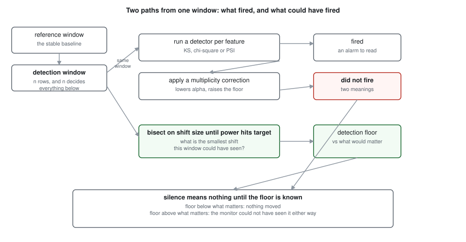
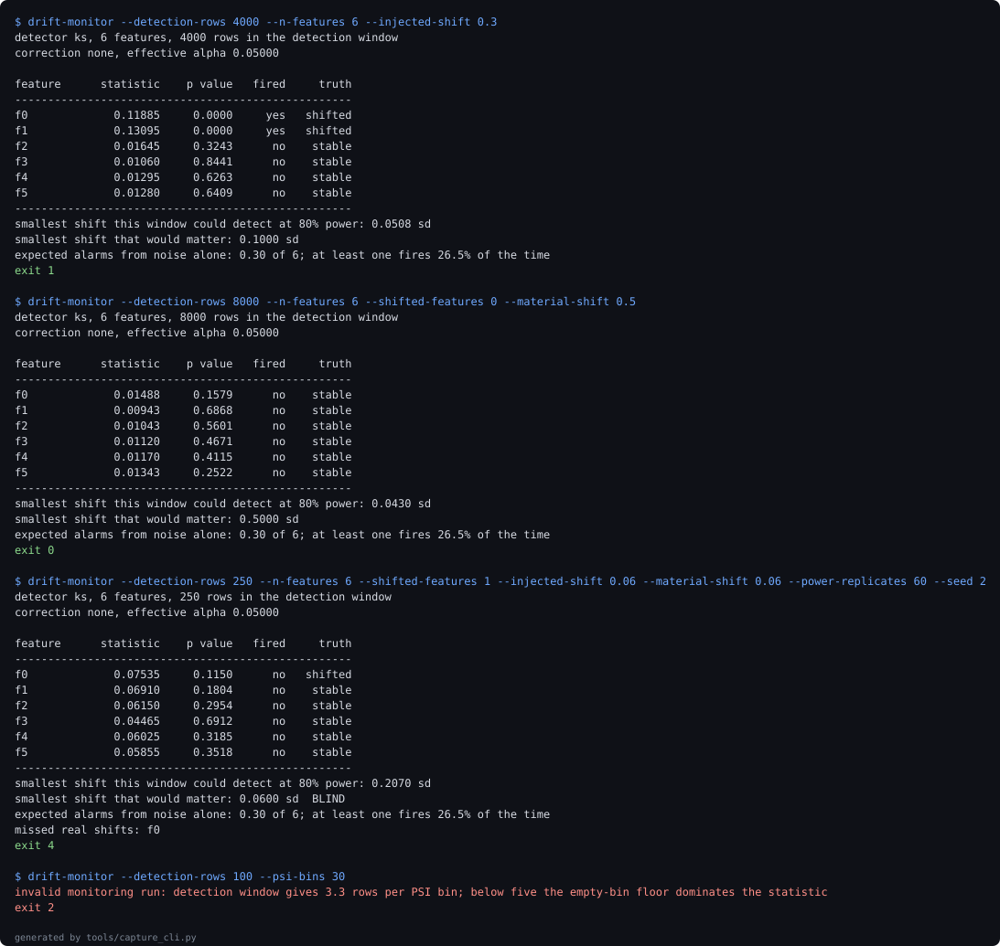

# window-blind-drift-monitor

**Reports which features a drift monitor is structurally unable to see at its current window size, and prices what fixing its false alarm rate costs in detection power.**

[](https://github.com/jayanthkodamachili/window-blind-drift-monitor/actions/workflows/ci.yml)


## What a drift report cannot tell you

A drift monitor that says nothing is making one of two claims, and the report looks identical either way:

- nothing moved, or
- something could have moved by more than anyone would tolerate and this window would not have noticed.

Which one you are looking at depends on the detection window size, and that is the one number the alarm never prints. Four questions this answers that an ordinary drift report structurally cannot:

1. What is the smallest shift this window could have detected at all.
2. Given how many features are tested in one pass, how many alarms to expect on a day when nothing happened.
3. Whether the PSI thresholds in the runbook mean the same thing at this window size as at any other.
4. What controlling the false alarm rate costs in detection power, because it is not free.

## The numbers

- With **zero drift anywhere**, a forty-feature monitor **fires on 0.875 of** runs. Per feature the rate **sits at 0.046**, correctly at alpha; it is the fan-out that produces the alarm, and on average **1.85 features light up** per quiet day.
- A 250-row window has a detection **floor of 0.2051 sd**. At 20000 rows it falls **down to 0.0254 sd**. **3 of 7 window** sizes cannot see a 0.1 sd shift at all, which means on those windows the absence of an alarm carries no information.
- **The uncomfortable one:** fixing the alarm rate makes the monitor blinder. Bonferroni across forty features takes the alarm probability **from 0.871** **to 0.049 after**, and raises the detection floor **from 0.0762 sd** **rises to 0.1113 sd**, **a factor of 1.46**. **At 20 features** the monitor crosses from seeing a material shift to not seeing it, purely as a consequence of the correction.

108 tests, 100 percent line coverage, and every figure above is re-measured by CI from the experiments rather than typed into this file. `tools/check_numbers.py` fails the build if any of them drifts.

## Quickstart

Requires Python `3.11` or newer. No credentials, no network at runtime.

```bash
pip install -e ".[dev]"

# a quiet window that could have seen something, then one that could not
drift-monitor --detection-rows 8000 --n-features 6 --shifted-features 0 --material-shift 0.5
drift-monitor --detection-rows 250 --n-features 6 --shifted-features 1 \
              --injected-shift 0.06 --material-shift 0.06 --power-replicates 60 --seed 2

# everything: lint, suite, re-measure all four experiments, check the prose
make verify
```

The two commands print nearly identical tables. The first exits 0 and the second exits 4, and the difference is the whole repository.

## The claim, one section at a time

### An alarm on a quiet day is the normal case

| features monitored | at least one fires | predicted from the per-feature rate | expected alarm count |
| --- | --- | --- | --- |
| 1 | 0.033 | 0.046 | 0.05 |
| 5 | 0.223 | 0.211 | 0.23 |
| 10 | 0.360 | 0.377 | 0.46 |
| 20 | 0.560 | 0.612 | 0.93 |
| 40 | 0.875 | 0.850 | 1.85 |
| 80 | 0.968 | 0.977 | 3.70 |

Nothing drifted in any replicate. Every alarm counted here is false.

The measured column and the column predicted from the per-feature rate agree within **no more than 0.052**, which is the check that the fan-out is ordinary multiplicity arithmetic rather than something specific to this setup. Nothing here is surprising to anyone who has thought about it for a minute. The point is that drift dashboards rarely publish either column, so the team reading the alarm has no way to know that a quiet system produces one most days.

### What each window size can see

| detection window rows | floor at 80% power (sd) | verdict against a 0.1 sd shift | floor times sqrt(n) |
| --- | --- | --- | --- |
| 250 | 0.2051 | blind | 3.24 |
| 500 | 0.1465 | blind | 3.28 |
| 1000 | 0.1035 | blind | 3.27 |
| 2000 | 0.0762 | visible | 3.41 |
| 5000 | 0.0488 | visible | 3.45 |
| 10000 | 0.0332 | visible | 3.32 |
| 20000 | 0.0254 | visible | 3.59 |

The right-hand column is the check. A fixed-power detection floor falls as one over the square root of the sample size, so this product should be constant down the table; across an eighty-fold range of window sizes it varies by a **factor of 1.11**. The bisection that produced the floors knows nothing about that identity, so the agreement is evidence that it found a real quantity.

### The PSI thresholds do not travel

PSI is compared against 0.1 and 0.2, two numbers that know nothing about how much data went into the statistic. Here is PSI on windows where nothing has drifted at all:

| detection window rows | median null PSI | 95th percentile | share over 0.1 | share over 0.2 |
| --- | --- | --- | --- | --- |
| 250 | 0.0346 | 0.0674 | 0.005 | 0.000 |
| 500 | 0.0175 | 0.0351 | 0.000 | 0.000 |
| 1000 | 0.0088 | 0.0181 | 0.000 | 0.000 |
| 2000 | 0.0042 | 0.0089 | 0.000 | 0.000 |
| 5000 | 0.0019 | 0.0035 | 0.000 | 0.000 |
| 20000 | 0.0006 | 0.0012 | 0.000 | 0.000 |
| 100000 | 0.0003 | 0.0005 | 0.000 | 0.000 |

The null median **falls 133-fold** across the table. The 0.2 action threshold never fires in **7 of 7 window sizes**, which is not reassurance: on a 2000-row window PSI's per-feature fire rate against real drift is **a rate of 0.000** too. A threshold that nothing reaches is not a conservative threshold, it is a disconnected one.

That table holds the reference window large and stable. A team that retrains monthly compares last month against the month before, so both windows are small:

| rows in both windows | median null PSI | share over 0.1 |
| --- | --- | --- |
| 250 | 0.0652 | 0.182 |
| 1000 | 0.0182 | 0.000 |
| 5000 | 0.0032 | 0.000 |
| 20000 | 0.0008 | 0.000 |

At **250 rows per window** the null median **sits at 0.0652**, two thirds of the way to the investigate threshold with nothing drifting, and **0.182 of pure-noise** comparisons cross it. The same runbook rule produces constant false alarms on one window size and perfect silence on another.

### What it costs against what it buys

| features | corrected alpha | alarm rate before | alarm rate after | detection floor | verdict |
| --- | --- | --- | --- | --- | --- |
| 1 | 0.05000 | 0.050 | 0.050 | 0.0762 | visible |
| 5 | 0.01000 | 0.226 | 0.049 | 0.0918 | visible |
| 10 | 0.00500 | 0.401 | 0.049 | 0.0957 | visible |
| 20 | 0.00250 | 0.642 | 0.049 | 0.1035 | blind |
| 40 | 0.00125 | 0.871 | 0.049 | 0.1113 | blind |
| 80 | 0.00063 | 0.983 | 0.049 | 0.1152 | blind |

What it buys: an alarm rate that means what it says. What it costs: a detection floor that rises until the monitor stops being able to see the thing it was installed to watch for.

The honest reading is not "apply Bonferroni and carry on". It is that a monitor's alarm rate and its sensitivity are one dial with two ends, and a team that tunes one end without measuring the other has moved the problem rather than solved it. The fix is a bigger window, which this repository can size but cannot conjure.

## The bugs the measurement found

**PSI reported confident drift between two identical distributions.** An early window sweep reached 50 rows against 20 PSI bins. Several bins came back empty, the epsilon floor in the PSI formula turned each empty bin into a large positive contribution, and the statistic produced a decisive score built out of nothing. The sweep completed and looked successful. The config now refuses a window below roughly five rows per bin, at the point the run is described.

**A test assumed PSI would be blind at tiny windows and was wrong.** The guess was that PSI on a sixty-row window would see nothing, so the floor search would hit its ceiling. It detected a shift well under one standard deviation comfortably. The reason is not that PSI is good at small windows: its null distribution is already inflated there, so it fires on almost anything. High power bought with a ruinous false alarm rate is not power, and the test now measures both numbers instead of one.

**The detection floor was nearly computed from the data it was judging.** The first version seeded the floor search from the monitor's own config seed, which meant the simulated windows shared a stream with the windows under test. The floor is a property of the window size and the detector, not of the data, and a test that varies the injected shift while asserting the floor does not move now pins that.

## Architecture



Generated by `tools/render_diagram.py` and committed. CI regenerates it and fails if the committed copy has drifted.

## Evidence



A replay of real stdout, captured by `tools/capture_cli.py`. The second and third runs are the argument: six quiet features in both, nearly identical tables, exit 0 and exit 4. Every command and the exit code it actually returned are in [docs/evidence-manifest.json](docs/evidence-manifest.json).

## The fixture

There is no committed dataset. Asking how often a monitor alarms when nothing has drifted requires knowing that nothing has drifted, and asking what size of shift it would have caught requires injecting shifts of known size. A production log supplies neither.

Features are standard normal and independent, which is the kindest possible case for a drift detector. Correlated features, heavy tails and seasonality all make detection harder, so every floor here reads as a best case rather than a worst one. The awkward cases the generator is set up to produce:

- A window of 250 rows, where the floor sits above anything worth acting on.
- A shift injected below the floor of the window it lands in, so the report has a real miss to name.
- Zero shifted features, which is how the false alarm rate is measured at all.
- A window too thin for its PSI bins, so the guard has something real to refuse.

## What this cannot measure

Its own section, because these are the limits a reviewer should know before trusting anything above.

- **Mean shifts in independent normal features only.** Real drift arrives as changing correlation, a new category, a long tail growing heavier, or a shift in a feature nobody is monitoring. The detection floors here are for the easiest case and should be read as a ceiling on how well a real monitor does.
- **No temporal structure.** Windows are independent draws. Real monitoring has autocorrelation, weekly seasonality, and windows that overlap, each of which changes the effective sample size in ways this does not model.
- **Detection, not consequence.** A shift being detectable says nothing about whether it would hurt the model. A large drift in a feature with no influence is noise, and a small drift in a decisive one is an incident. Ranking by impact rather than detectability is the obvious next thing and is not here.
- **The material shift is an input, not a finding.** Everything labelled blind is blind relative to a threshold someone has to choose. The repository makes that choice explicit and visible; it does not make it for you.
- **Floors are simulation estimates.** Each one comes from a bisection over simulated power with a finite replicate count, so it carries error. The square-root invariant is published as a check on that, and it holds to a factor of 1.11 rather than exactly.
- **Declared, not observed:** that a standard normal feature resembles a production feature in any respect that matters.

See [ADR-005](docs/adr/ADR-005-what-this-cannot-measure.md).

## Layout, exit codes and reproduction

```
src/drift_monitor/
  config.py      frozen run, refuses a window too thin for its bins
  generate.py    seeded windows with shift injected into named features
  detectors.py   KS, PSI and chi-square, and the asymmetry between them
  power.py       the detection floor search and its invariant
  monitor.py     orchestration, multiplicity correction, the blind set
  cli.py         exit codes that separate two kinds of silence
experiments/     four experiments writing JSON to docs/experiments
tools/           metric collection, number checker, diagram, capture
docs/adr/        five decision records
```

| exit code | meaning |
| --- | --- |
| 0 | nothing fired, and a shift worth acting on would have been seen |
| 1 | drift detected |
| 2 | the run was rejected before any computation |
| 3 | the run itself failed |
| 4 | nothing fired, and nothing worth acting on could have been seen |

Codes 0 and 4 are the pair that matters. An ordinary drift monitor collapses them into one, and they mean opposite things.

| target | what it does |
| --- | --- |
| `make lint` | ruff |
| `make test` | suite with a coverage floor |
| `make experiments` | re-runs all four, rewriting their JSON |
| `make figures` | regenerates the diagram and the captured session |
| `make receipts` | re-measures every figure, then checks the prose |
| `make verify` | lint, test, receipts |

The number checker matches anchor phrases rather than bare digits, in both directions. Forward, every metric must appear in a checked document using its anchor wording. Backward, every decimal in the prose must correspond to a metric. Change any figure in this README, run `python tools/check_numbers.py`, and watch it fail.

## Stack

| technology | role | why here |
| --- | --- | --- |
| scipy.stats | KS and chi-square | their null distributions account for sample size, which is the property under examination |
| numpy | generation, binning, the bisection | PSI is a histogram and a log, and belongs in the open where it can be read |
| pytest with a coverage floor | the suite | the invariant check is a test, so a broken claim fails the build |
| ruff | lint and import order | one tool, one CI step |
| plain SVG, hand written | the diagram | a committed file renders the same in both themes, which a Mermaid fence does not reliably do |
| no drift library | deliberately absent | the subject is what these detectors cannot do, and a library would hide the thresholds being questioned |

## Decision records

1. [ADR-001: a simulated detection floor rather than an analytic one](docs/adr/ADR-001-simulated-floor.md)
2. [ADR-002: PSI is implemented and criticised rather than omitted](docs/adr/ADR-002-keep-psi.md)
3. [ADR-003: one shared floor per run rather than one per feature](docs/adr/ADR-003-shared-floor.md)
4. [ADR-004: a committed SVG rather than a Mermaid fence](docs/adr/ADR-004-committed-svg.md)
5. [ADR-005: what this repository deliberately cannot measure](docs/adr/ADR-005-what-this-cannot-measure.md)

## The Pivot

Ranking drift by its effect on the model is deliberately out of scope. Everything here measures whether a shift is visible, not whether it matters.

The trigger for adding it is specific: the moment anyone uses a blind-feature list to decide where to spend engineering effort. At that point detectability is the wrong ordering, because a feature the model barely uses can be perfectly visible and entirely uninteresting, and the question becomes which drift moves predictions.

Future work, in order:

- Weighting features by their influence on the model's output, so the blind set is ordered by consequence.
- Multivariate drift, where no single feature moves but their joint distribution does.
- Overlapping and autocorrelated windows, which change the effective sample size the floor is computed from.
- A real monitoring log, to see which of these floors survive contact with seasonality.
- First metric to watch on any of these: whether the floor times the square root of the window stays constant, because every result here rests on that invariant holding.

